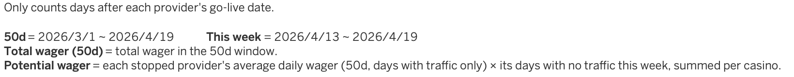
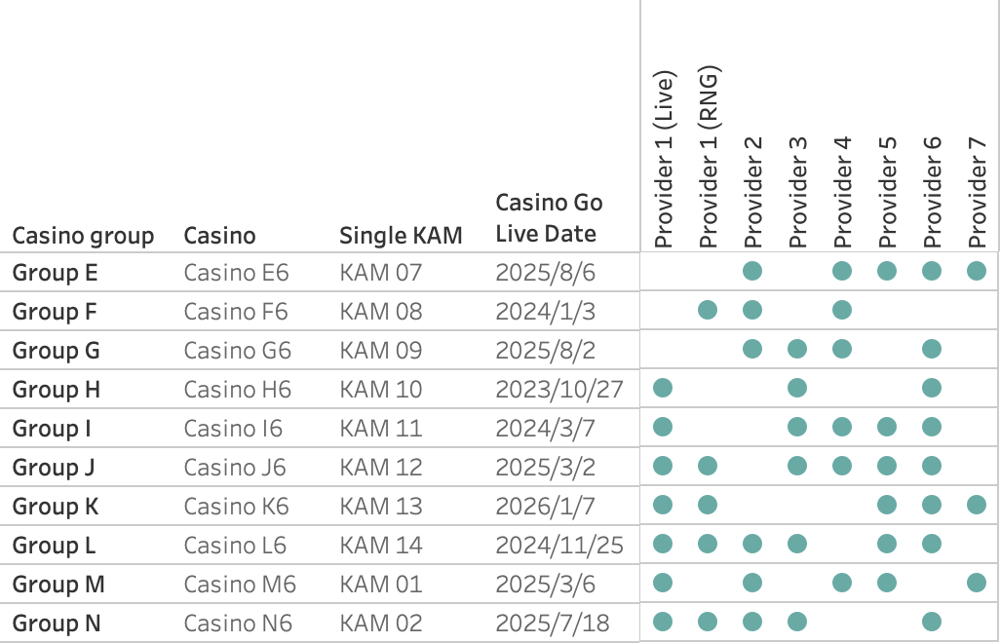
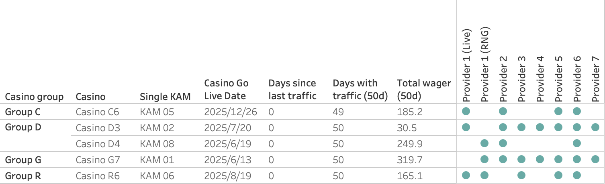
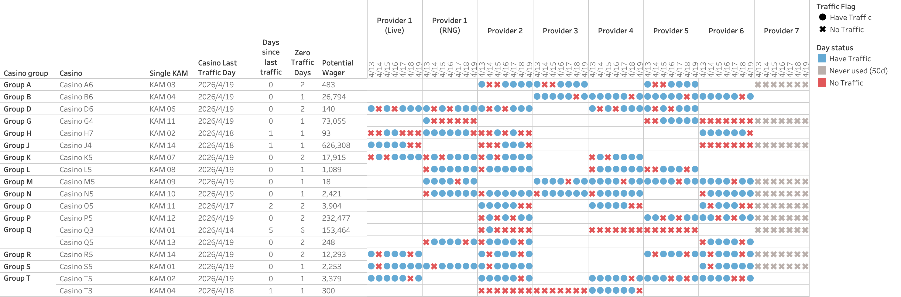
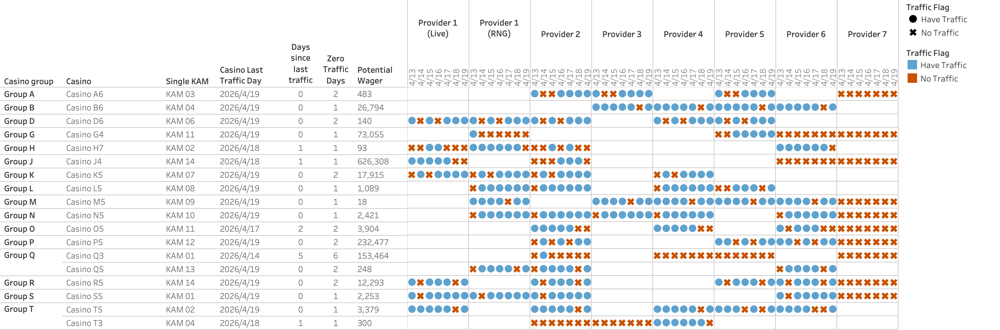

# Zero Traffic Alert — Redesigning an alert nobody read

A daily alert went out to every account manager on the team. Almost nobody acted on it.
This is the story of why that was a structural problem rather than a design one — and what I rebuilt in its place.

> **Note:** This is a recreation of internal work using synthetically generated data.
> No real companies, people, accounts or figures are included. The dataset is produced by
> [`data/generate_synthetic_data.py`](data/generate_synthetic_data.py), which reproduces the
> statistical *shape* of the original problem — heavy-tailed revenue, batch-enabled dead
> integrations, intermittent outages — without reproducing any of its content.

---

## Overview

The product is a B2B games platform. Each client casino runs several game providers, and every
provider on every casino should be producing traffic every day. When one stops, somebody should
find out why — a broken integration, a client-side change, or a line the client quietly turned off.

A daily email existed to catch exactly this. It listed every casino × provider combination with
zero traffic. It had been running for a long time, and the people receiving it had mostly stopped
reading it.

I was asked to find out whether it still fit how the account managers actually work.
It didn't — and the reason turned out to be more interesting than "it needs a redesign".

---

## The finding

I interviewed three account managers separately. None of them used it as an alert.
One described his actual workflow:

> *"Every few months I go through all my lines and see which ones have no data and should be
> closed — like when you have a lot of clutter you don't use, you declutter."*

That is housekeeping, not alerting. And a second manager, in a completely unrelated conversation,
explained why:

> *"The big ones never go all the way to zero. They drop. And when they drop, that's when you
> start paying attention."*

Which gives the structural answer:

> **Zero traffic is an end state, not an early signal. Early warning requires a gradient, and
> `= 0` has no gradient.**

Plot the client base against that threshold and it covers the wrong end of the distribution:

```
small clients   → routinely hit zero    → appear every day  → pure noise
mid-size        → decline, rarely zero  → never appear      → the only actionable band ← missed
large clients   → almost never zero     → never appear      → invisible
```

So the metric itself determined the ceiling: **the only action this alert could ever produce was
cleanup, not rescue.** No amount of visual redesign changes that, because the problem is the
threshold, not the layout.

That reframed the project. Instead of making the alert better at being an alert, I made it good
at the job it was actually capable of — and made the routing explicit so people could tell in two
seconds which of their accounts needed what.

---

## Analytical decisions

The redesign is a series of judgement calls. These are the ones that mattered, and why I went
the way I did.

**Why route casinos into mutually exclusive tables, rather than one ranked list**

The original produced three overlapping blocks, and a casino could appear in more than one. That
sounds harmless, but it means a reader cannot tell what a row is asking of them: is this account
dead, underperforming, or broken this morning? Those need three different responses — close the
line, review the commercials, call the client today. Routing each casino into exactly one table
turns "here is a list of problems" into "here is what to do about each one". Every casino now
appears in exactly one of four tables, and the routing is enforced by the filter logic rather than
by convention.

**Why separate "never live" from "stopped working"**

Both look identical in the data — zero traffic — and the original treated them the same. But a
line that has never produced a single transaction since go-live is a provisioning or commercial
question, while a line that ran for months and stopped last Tuesday is an incident. Merging them
meant the incidents were buried under hundreds of provisioning leftovers. Splitting them was the
single biggest reduction in noise, because the never-live population is large and almost entirely
static.

**Why rank by wager missed *this week*, rather than by total lost revenue**

The obvious ranking metric is cumulative: average daily wager × days down. It is also wrong for
this purpose. A small line down for three weeks accumulates more than a large line that broke
yesterday — but the one that broke yesterday is the one you can still save. Bounding the estimate
to the current week (zero-traffic days can only be 0–7) keeps the ranking ordered by
*actionability* rather than by accumulated regret, and keeps yesterday's large break at the top
where it belongs.

**Why the alert threshold came from list length, not from the data**

The revenue cut-off separating "worth a call" from "worth ignoring" has no natural break point —
daily wager spans five orders of magnitude and is close to log-uniform, so any cut looks arbitrary
from inside the distribution. I set it from the other end instead: an account manager can work
through roughly three to five accounts a week, so the threshold is whatever produces that list
length. It is also a number you can defend in a meeting — nobody agrees on €500, everybody agrees
on "about four accounts a week."

**Why dead providers are greyed out rather than filtered away**

One provider had been enabled across most of the client base in a single batch and never carried a
single transaction. It contributed a loud red cell to nearly every row — the most visually
dominant thing on the page was also the most meaningless, which is exactly how readers learn to
ignore red. But removing it entirely would hide a genuinely broken line if that provider ever did
go live, and hard-coding a provider name is a rule that silently rots the moment somebody enables a
different one. Encoding the *condition* — "has never produced traffic inside the window" — as a
distinct grey state is provider-agnostic, self-maintaining, and preserves the contrast that makes a
row diagnosable: four green cells and one red means a provider problem; five red means the casino
itself stopped.

---

## What changed

| | Original | Redesign |
|---|---|---|
| Structure | 3 overlapping blocks | 4 mutually exclusive tables + a header that states the windows |
| Can a casino appear twice? | Yes | No — enforced in the filter logic |
| Never-live vs stopped | Merged | Separated into different tables |
| Ordering | Alphabetical | By estimated wager missed this week |
| Dead integrations | Rendered as urgent red | Distinct grey state, provider-agnostic |
| Thresholds | Hard-coded | Parameterised and shown in the header |
| Cadence | Daily, fires even when empty | Weekly, suppressed when there is nothing to report |

---

## The four tables

### Header — every window the page uses, stated once


The original never said out loud that one of its blocks silently required the casino to be
healthy overall. Readers had to infer the routing from which rows appeared where. Every window,
threshold and definition is now printed at the top and driven by the same fields the tables use,
so the page cannot describe a rule it isn't applying.

### 1 — Never live in the window


Casinos with no traffic at all across the whole 50-day window. The go-live date is shown next to
each: an old date still at zero is a dead line to close; a recent one may simply not have started.
**Action: does this line still need to exist?**

### 2 — Underperforming


Casinos that do produce traffic, but under the cleanup threshold in total across 50 days. These
are commercially marginal rather than broken. **Action: is this worth keeping open?**

### 3 — Whole casino went dark this week


Casinos above the threshold where every provider stopped on the same day or days. Provider × day
grid, so the shape of the outage is visible — one bad day looks different from a slow fade.
**Action: connection, client-side change, or planned?**

### 4 — A provider stopped at an otherwise-healthy casino


The casino itself ran every day this week, but one or more of its providers did not. This is the
diagnostic view: the surviving green cells are what tell you the client is alive and reachable, and
that the fault is specific to one integration rather than to the account.
**Action: is that provider still meant to be live for this client?**

---

## Noise reduction

Measured on the synthetic dataset in this repo, so every figure below is reproducible by running
`data/generate_synthetic_data.py` and opening the workbook.

| Routing | Casinos | Share |
|---|---|---|
| ① Never live in the window | 10 | 7.7% |
| ② Underperforming | 10 | 7.7% |
| ③ Whole casino dark this week | 13 | 10.0% |
| ④ Provider stopped, casino healthy | 40 | 30.8% |
| Healthy — not listed at all | 57 | 43.8% |

- **Duplicate routing: 0.** Every casino lands in exactly one table.
- **Requiring action this week (③ + ④): 53 casinos across 14 account managers ≈ 3.8 each.**
- Excluding providers that have never carried traffic from the routing test removes **34 casinos**
  from table ④ — casinos that were listed *only* because of one batch-enabled integration that
  had never gone live. That single condition is 46% of that table.

**Status: the redesign is built and approved; it has not yet run long enough in production to
measure.** The number that would actually prove or disprove it is the week-over-week repeat rate —
what share of this week's rows are the same casino × provider as last week's. That is the next
thing I would build, and I would rather say so than quote an impact figure I have not measured.

---

## What I'd do next

1. **Quantify the repeat rate.** Snapshot the routing weekly and measure how much of each list is
   carried over. A cleanup list should shrink; an alert list should churn. If neither happens, the
   redesign didn't work.
2. **Split "never live" by go-live date.** A line enabled last week and a line enabled two years
   ago are both at zero, but one is "wait" and the other is "close". The data supports the split;
   the current version doesn't make it.
3. **Hand the early-warning job to a decline-detection view.** Nothing built on `= 0` can catch the
   mid-size accounts that drop without ever hitting zero. That needs a relative-deviation metric
   and a separate surface — trying to bolt it onto this one would repeat the original mistake.

---

## Repository contents

| Path | What it is |
|---|---|
| [`workbook/`](workbook/) | The packaged Tableau workbook (`.twbx`), with data embedded — downloadable and openable |
| [`data/generate_synthetic_data.py`](data/generate_synthetic_data.py) | Generates the dataset; reproduces four real-world scenarios by construction |
| [`data/traffic_monitor_synthetic.csv`](data/) | 38,800 rows · 130 casinos · 8 providers · 50 days |
| [`docs/calculated-fields.md`](docs/calculated-fields.md) | Every calculated field, with the design reasoning and the Tableau order-of-operations traps |
| [`docs/user-guide.md`](docs/user-guide.md) | The guide written for the people who receive the report |

The user guide is included deliberately. A redesign that has to be explained in person hasn't
finished being designed, so writing the guide was part of the work rather than documentation
after it.

---

## Technologies used

- **Tableau** — nested FIXED level-of-detail expressions, parameterised thresholds, context-filter
  order of operations, dashboard routing logic
- **Python** (Pandas, NumPy) — synthetic data generation with controlled scenario distributions
- **SQL / Athena** — profiling the source grouping sets and provisioning tables during the
  investigation

---

## Live version

**[View the interactive dashboard on Tableau Public](URL)**

---

made with ✨ + 🌿 + 💛 by Chia Chang
