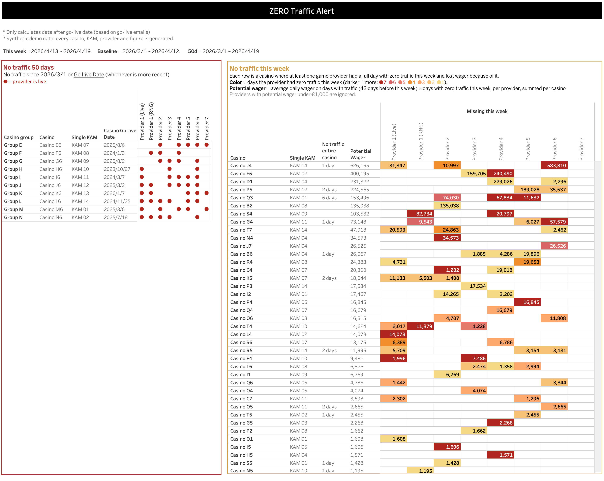

# Zero Traffic Alert User Guide

*This is the guide the account managers receive every week, with names replaced by the synthetic ones used in this repository. Every casino, manager, provider and figure here is generated.*

The alert gives you, at a glance, the casinos with no traffic on some day this week and the casinos with no traffic for 50 days.

---

## Definitions

- **Report day:** the last day with data. All windows end on this day (dates shown at the top of the page).
- **This week:** the 7 days ending on the report day.
- **Baseline:** the 43 days before this week. For each provider, its **average daily wager over the days it actually had traffic** in that window.
- **Zero-traffic day:** a day on which a provider at a casino had no wager at all. Counted per provider, and separately for the whole casino (all providers together).
- **Potential Wager:** for each provider that had at least one zero-traffic day this week: *its average daily wager × its zero-traffic days this week*. Summed per casino. The row total always equals the sum of the colored cells in that row.
    
    → This answers: at the rate this provider normally runs, how much did the no traffic days cost?
    
    Example (not from any specific casino):
    
    | Provider | Avg daily wager (days with traffic) | No traffic days this week | Potential Wager | Counts? |
    | --- | --- | --- | --- | --- |
    | Provider 1 (Live) | 300,000 | 0 | – | no — has traffic every day |
    | Provider 1 (RNG) | 40,000 | 2 | **80,000** | yes |
    | Provider 2 | 3,000 | 4 | **12,000** | yes |
    | Provider 3 | 120 | 7 | 840 | no — potential under €1,000 |
    | Provider 5 | 800 | 1 | 800 | no — potential under €1,000 |
    
    → Potential Wager = 80,000 + 12,000 = **92,000**
    

### What is not included

A provider counts when **its potential this week is at least €1,000** (average daily wager × zero-traffic days). Two reasons for the number:

- **Below €1,000 it cannot be told apart from an ordinary week.** For the smallest providers on this table the normal week-to-week swing is about €900. Larger providers lose far more than €1,000 from a single no traffic day, so €1000 is strict for small providers and sensitive for large ones.
- **It is not worth attention at this point.** It drops the very small lines whose silence is normal anyway: in the 5 weeks we measured, two out of three providers under €1,000/week had at least one full no traffic day. Those lines add up to 0.001% of all wager; if they stay silent they will show on the 50 day list at some point.

I set this value as a workbook parameter. The number was decided based on 5 weeks of data and is suggested to be re-evaluated at least every quarter. The data behind it is in `design-decisions.md`.

---

## No traffic this week

**Each row is a casino where at least one provider had a full day with zero traffic this week.** Casinos that ran every day, even if they did less than usual, are not in this table. Biggest potential first.

| Column | Meaning |
| --- | --- |
| No traffic entire casino | How many days this week the **entire casino** (all providers together) had zero traffic. Blank = the casino had some traffic every day. |
| Potential Wager | € the silent days cost this week, across the providers that had zero-traffic days. Rows are sorted by this. |
| Provider cells | **Color** = how many days this week that provider had zero traffic (darker = more). **Number** = that provider's potential (average daily wager × zero-traffic days). |
| Blank cell | Nothing worth attention: the provider ran every day this week, or is not set up for this casino, or its potential is under €1,000. |

**Understanding the rows and cells**

| What you see | What it means | How to interpret it |
| --- | --- | --- |
| Whole row colored, "No traffic entire casino = 7 days" | The whole casino stopped, all week. | Is it some kind of technical issue, switched off, or moved? |
| Whole row colored, "No traffic entire casino" is blank | Each provider had its own zero days, but never all on the same day. The casino as a whole was never dark. | Is it a lobby or integration change? |
| One dark cell, large number | One important provider stopped for the week. | Did the casino remove it from lobby? integration broken? |
| One light cell, large number | A big provider went dark for a day or two. | Most valuable case: one day earlier saves one day's wager. |
| Several dark cells, small numbers | Small providers dead for a long time. | Likely going to reach the 50 day list next month. |

Hover over any cell to see that provider's average daily wager, how many days that average is based on, and its zero-traffic days this week.

→ **Why did this stop?** Connection, client-side change, lobby change, or planned?

## No traffic 50 days

**Casinos with zero traffic for the whole 50-day window**, or since their go-live date if they went live more recently. ● = provider is live for this casino.

| Column | Meaning |
| --- | --- |
| Casino Go Live Date | When this casino went live. 
An old date + still no traffic = long dead. 
A recent date = maybe just not started yet. |

→ **Does this line still need to exist?** If not, close it so we stop maintaining settings for it.

---

## Good to know

- Potential wager is the silent days priced at the provider's own normal daily rate. A provider with 7 zero-traffic days shows a full week of its usual wager; one with 1 zero day shows one day's worth. Color tells you how long, while the number tells you how much.
- The average only uses days with traffic. That is deliberate, so a new casino appears at its real rate from week one, and a casino that has been quiet for a while is not measured against a diluted baseline. The flip side: a provider that ran on only a couple of days in the whole window is measured on those days and can look bigger than it is. The tooltip shows how many days the average is based on.
- A casino that shuts down for good stays in *No traffic this week* until it reaches the 50 day list, and its potential stays at the level it used to run at.
- A big client that is shrinking but never hits zero is out of scope here.
- Only dates after each casino's go-live are counted.

---

